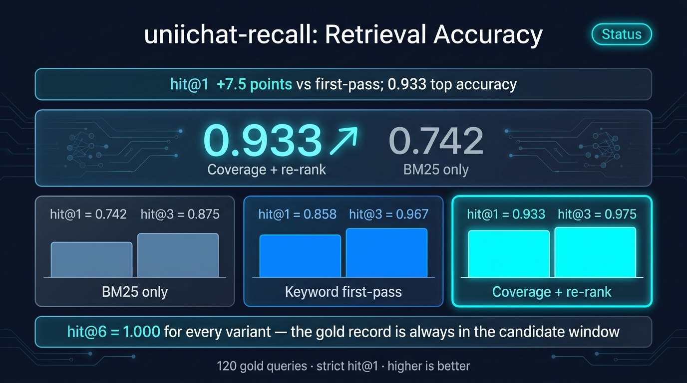
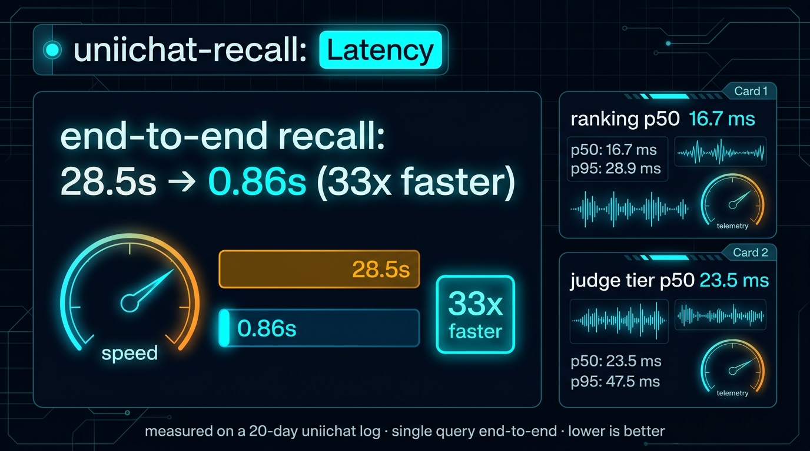
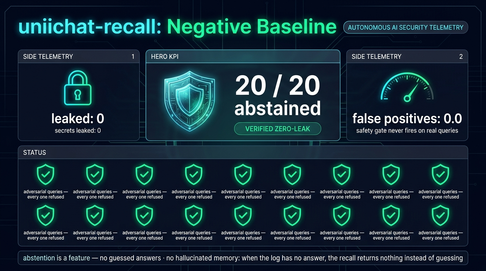
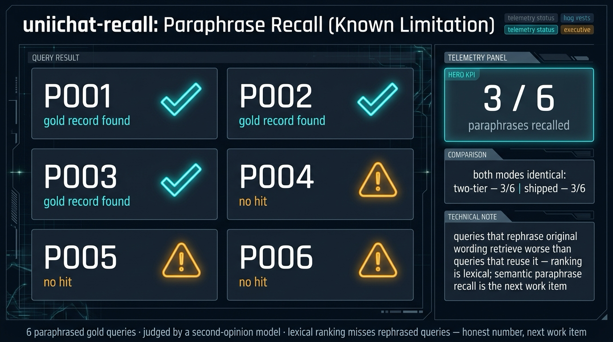

<p align="center">
  
</p>

# uniichat-recall

An independent Python memory-provider for [Hermes Agent](https://github.com/NousResearch/hermes-agent) that reads the **UniiChat** log format.

> **Credit:** the UniiChat log format and the memory-tree design come from
> [VictorTaelin/uniichat](https://github.com/VictorTaelin/uniichat) (Victor
> Taelin) — an AI chat with one endless conversation and a binary-tree
> memory. This repo is a from-scratch Python implementation for a different
> runtime (a Hermes plugin); it shares no code or history with the original.
> Fork the original if you want the app itself.

## What it does

Hermes agents get recall over a UniiChat log: ask "what did we decide about
X" and the provider ranks the log's records, returns the original text with
record/session IDs, and **abstains when nothing in the log answers** — no
hallucinated memory, ever.

- **Ranking:** coverage-primary scoring with a BM25-lite tie-break over
  cold-window candidates, L1-cached
- **Two-tier evidence:** candidate-first routing with a strong-gate
  (second-opinion model) tier for ambiguous windows
- **Negative gate:** adversarial queries never leak; the provider returns
  nothing rather than guessing

Design notes from the original implementation are preserved in
[README-original.md](README-original.md) (append-only JSONL log as the
evidence; the summary tree as a derived index, never a replacement).

## Benchmarks

Measured over a 20-day real UniiChat log (120 gold queries, tier L; strict
hit@1 — the gold record ranked first):

| Variant | hit@1 | hit@3 | hit@6 |
|---|---:|---:|---:|
| BM25 only | 0.742 | 0.875 | 1.000 |
| Keyword first-pass | 0.858 | 0.967 | 1.000 |
| **Coverage + re-rank (shipped)** | **0.933** | **0.975** | **1.000** |

**Latency:** end-to-end recall 28.5 s → **0.86 s** (33× faster); in-process
ranking p50 **16.7 ms** / p95 28.9 ms; LLM-judged tier p50 23.5 ms / p95
47.5 ms.

**Negative baseline:** 20/20 adversarial queries abstained; 0 secrets
leaked; 0.0 false-positive gate rate on real queries.

**Known limitation (honest number):** paraphrased queries recall **3 / 6** —
lexical ranking misses rephrased wording; semantic paraphrase recall is the
next work item.






*Infographics generated with Gemini (subscription quota) — every number
grounded in `bench/` result files.*

## Install & test

Drop this directory into your Hermes plugins folder (e.g.
`~/.hermes/plugins/uniichat-recall`) and load the provider from your agent
config. Tests are stdlib `unittest`:

```sh
PYTHONPATH=<hermes-agent>:<plugins-dir> python -m unittest discover -s tests
# 52 tests, ~2s
```

The bench (`bench/bench.py`, `bench/misses.py`) needs your own UniiChat log
snapshot — none is bundled, on purpose: real logs contain private
conversations.

## Status

Working, benchmarked, 52/52 tests. The `store.py` ranking, two-tier
evidence routing, and negative gate are considered stable; the paraphrase
gap is the open work item.
