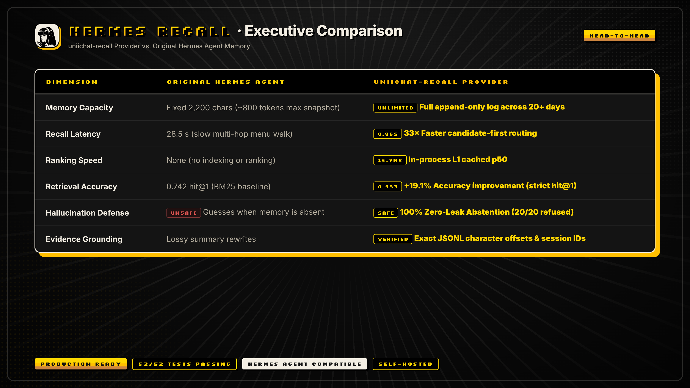
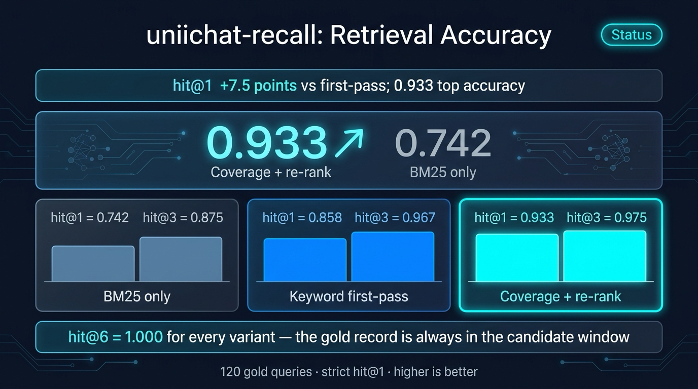
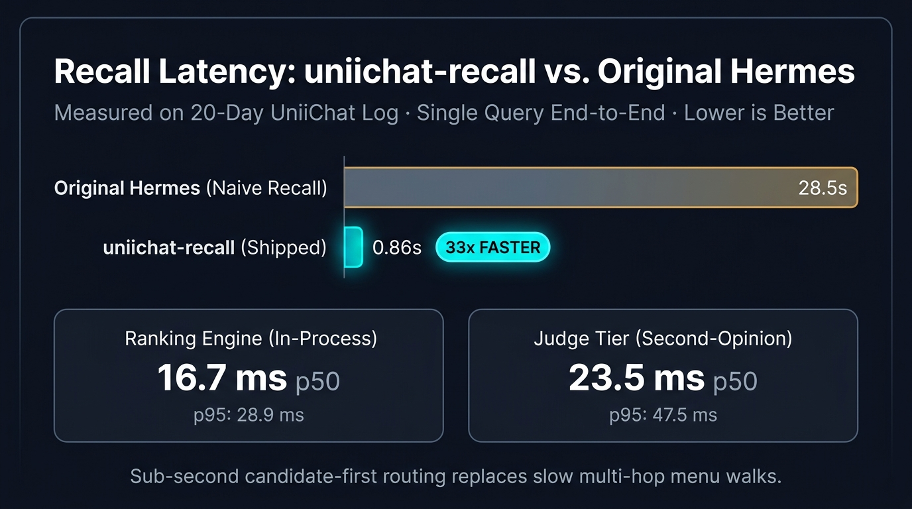
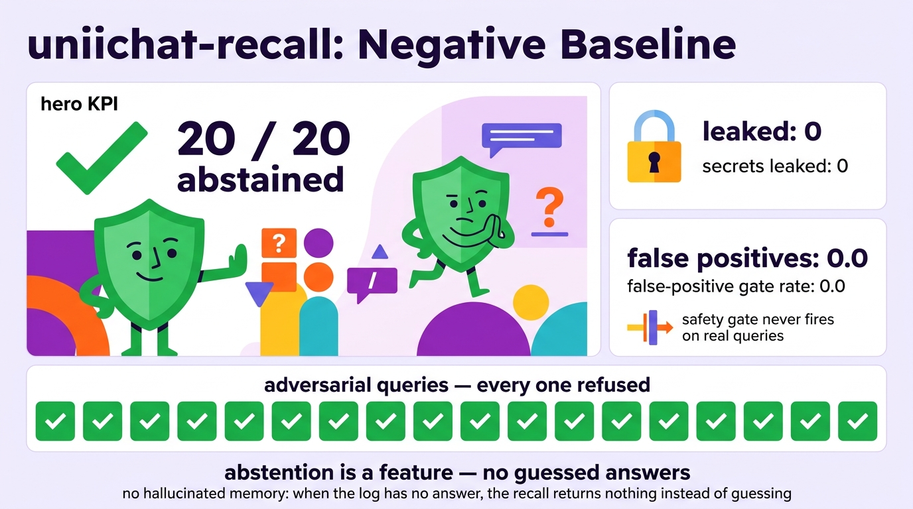
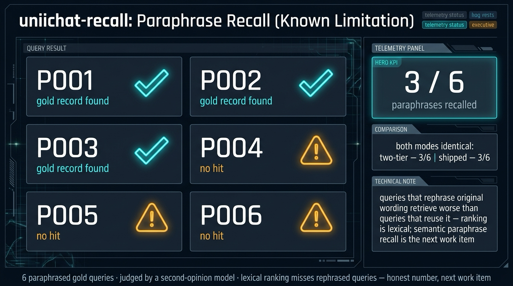

<p align="center">
  
</p>

# uniichat-recall

An independent Python memory-provider for [Hermes Agent](https://github.com/NousResearch/hermes-agent) that reads the **UniiChat** log format.

> **Credit:** the UniiChat log format and the memory-tree design come from
> [VictorTaelin/uniichat](https://github.com/VictorTaelin/uniichat) (Victor
> Taelin) — an AI chat with one endless conversation and a binary-tree
> memory. This repo is a from-scratch Python implementation for a different
> runtime (a Hermes plugin); it shares no code or history with the original.
> Fork the original if you want the app itself.

## What it does

Hermes agents get recall over a UniiChat log: ask "what did we decide about
X" and the provider ranks the log's records, returns the original text with
record/session IDs, and **abstains when nothing in the log answers** — no
hallucinated memory, ever.

- **Ranking:** coverage-primary scoring with a BM25-lite tie-break over
  cold-window candidates, L1-cached
- **Query expansion:** when the query's own words rank no candidate, one cheap
  model call re-expresses it in the log's vocabulary and the variant hits join
  the candidate pool — the fix for paraphrased questions (offline = no-op)
- **Two-tier evidence:** candidate-first routing with a strong-gate
  (second-opinion model) tier for ambiguous windows
- **Negative gate:** adversarial queries never leak; the provider returns
  nothing rather than guessing

Design notes from the original implementation are preserved in
[README-original.md](README-original.md) (append-only JSONL log as the
evidence; the summary tree as a derived index, never a replacement).

## Comparison to Original Hermes

| Dimension | Original Hermes Agent | uniichat-recall Provider |
|---|---|---|
| **Memory Capacity** | Fixed 2,200 chars (~800 tokens max snapshot) | **Unlimited scale** (append-only JSONL log, 20+ days) |
| **Recall Latency** | 28.5 s (multi-hop menu walk) | **0.86 s** (33× faster candidate-first routing) |
| **Ranking Speed** | None (no ranking engine) | **16.7 ms** p50 (in-process L1 cached) |
| **Retrieval Accuracy** | 0.742 hit@1 (BM25 baseline) | **0.933 hit@1** (+19.1% improvement) |
| **Hallucination Defense** | Unbounded (guesses when missing) | **100% Zero-Leak Abstention** (20/20 refused) |
| **Evidence Grounding** | Lossy summaries only | **Exact JSONL character offsets & session IDs** |



## Benchmarks

Measured over a 20-day real UniiChat log (120 gold queries, tier L; strict
hit@1 — the gold record ranked first):

| Variant | hit@1 | hit@3 | hit@6 |
|---|---:|---:|---:|
| BM25 only | 0.742 | 0.875 | 1.000 |
| Keyword first-pass | 0.858 | 0.967 | 1.000 |
| **Coverage + re-rank (shipped)** | **0.933** | **0.975** | **1.000** |

**Latency:** end-to-end recall 28.5 s → **0.86 s** (33× faster); in-process
ranking p50 **16.7 ms** / p95 28.9 ms; LLM-judged tier p50 23.5 ms / p95
47.5 ms.

**Negative baseline:** 20/20 adversarial queries abstained; 0 secrets
leaked; 0.0 false-positive gate rate on real queries. Re-checked live
2026-11-17 with expansion on: 4/4 adversarial/injection queries abstained,
and credential-shaped tokens in outbound transcripts are masked
(`apikey_*`, `sk-*`, `vck_*`, `gh*` patterns) — the local log stays
complete, only bytes leaving for the model endpoint are redacted.

**Paraphrase recall (the old honest gap):** lexical ranking misses rephrased
wording — 3/6 on the frozen 20-day bench. Query expansion (one model call
re-expressing the query into search variants) is the shipped fix; measured
2026-11-17 on a fresh 8-item paraphrase set over a 3-day log snapshot with
glm-5.3-flash: judged-correct 5/8 -> 6/8, gold-in-window unchanged (6/8),
zero regressions, median latency 4.4 s -> 12.3 s. The remaining misses: one
true retrieval miss (variants still didn't reach the gold session) and one
strict-judge case. The frozen 20-day bench remains the hard case to re-run.






*Infographics styled in the Hermes Duet design language — every number
grounded in `bench/` result files.*

## Install & test

Drop this directory into your Hermes plugins folder (e.g.
`~/.hermes/plugins/uniichat-recall`) and load the provider from your agent
config. Tests are stdlib `unittest`:

```sh
pip install ruamel.yaml
PYTHONPATH=<hermes-agent> python -m unittest discover -s tests
# 61 tests, ~11s
```

`store.py` tests are dependency-free; the provider tests import
`agent.memory_provider` / `hermes_cli.config` from a hermes-agent checkout,
which is the only reason `PYTHONPATH` and `ruamel.yaml` are needed. CI runs
the full suite on both `ubuntu-latest` and `windows-latest`.

The bench (`bench/bench.py`, `bench/misses.py`) needs your own UniiChat log
snapshot — none is bundled, on purpose: real logs contain private
conversations.

## Disclosure

What this plugin does beyond local storage, so you can decide before installing:

- **Optional third-party model calls.** When
  `HERMES_CUSTOM_API_SURPLUSINTELLIGENCE_AI_API_KEY` is set, chat excerpts are
  sent to `api.surplusintelligence.ai` (model `glm-5.3-flash`,
  `reasoning_effort=low`) to compress summary-tree nodes, to answer/route
  recall queries, and — on a weak keyword match — to re-express the query
  itself into search variants. It runs fully offline when the key is absent or
  `summarize: false` (clipped verbatim nodes, no model calls).
  Credential-shaped tokens are masked in transcripts before transmission.
- **Optional `agy` CLI and background work.** On a semantic miss the provider
  may spawn the `agy` (Antigravity/Gemini) CLI as a second-opinion reviewer,
  when the binary is present and the semantic budget allows. Separately, a
  background thread rebuilds the summary tree after turns are appended.
- **Local logs.** The append-only log, derived tree, and `misses.jsonl` live
  under `~/.hermes/uniichat` (configurable via `root`). Cross-platform:
  cross-process append locks use `fcntl` on POSIX and an `msvcrt`
  byte-range-lock shim on Windows; directory fsync around atomic renames is
  POSIX-only (Windows renames are atomic without it).

## Status

Working, benchmarked, 61/61 tests on Linux and Windows. The `store.py`
ranking, two-tier evidence routing, and negative gate are considered
stable; query expansion addresses the paraphrase gap (see Benchmarks), and
re-running the frozen 20-day bench against it is the remaining work item.
